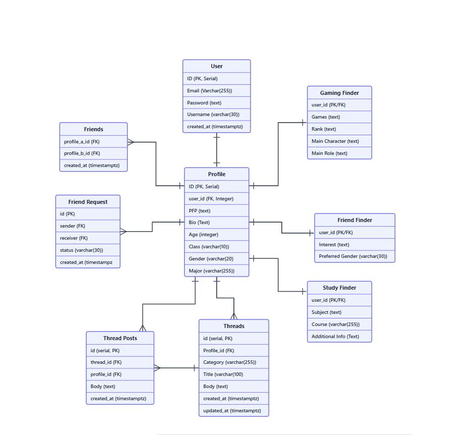

# Norm's Network

## Description
Welcome to Norm's Network, a hub for UNCC Students who are looking for people to talk to. Whether it be as a study buddy, a gaming partner, or a friend, NormsNetwork allows UNCC students to create a main profile for finding friends and navigate other parts of app to find the specific part they want and add information depending on the section they chose. Unlike other UNCC social networks, NormsNetwork seamlessly blends everything in one place so UNCC students don't have to go searching through tons of different apps to try and find people to communicate with.

## Sprint 2 Progress

Sprint 1 set up the database, the Express server, and placeholder pages. Sprint 2 turned that into a working app: students can now create an account, sign in, and build a profile, and every main page has a finished design.

### Completed this sprint

**Accounts and authentication** (PR #35)
- Sign up with a UNC Charlotte email (`@charlotte.edu` or `@uncc.edu`), a unique username, and a password of at least 8 characters
- Log in with either your email or your username, and log out from the navigation bar
- Passwords are hashed with scrypt, and sessions are saved in a new `sessions` table and last 7 days
- Pages that need an account (`/profile`, `/friends`) send logged-out visitors to the login page, then back to the page they wanted
- Security checks: cross-site form posts are blocked, and a failed login never reveals whether an account exists

**React and TypeScript migration** (PR #36)
- Converted the whole app from JavaScript to TypeScript in strict mode
- Pages are now React components rendered on the server and hydrated in the browser, with Vite building the frontend assets
- Fixed a development server restart loop

**App screens and design** (PR #37)
- New sign-up and log-in screens
- Home page that links to each part of the app
- Designed pages for the Friend Finder, Study Buddy Finder, Gaming Partner Finder, Public Threads, and Friends, with top and bottom navigation

**Profiles** (PR #38)
- Create, view, edit, and delete your main profile at `/profile`
- Profile fields: age, class standing, gender, major, bio, and an uploaded profile photo
- The form is checked on the server and keeps what you typed when a field needs fixing
- JSON API for profiles: `GET`, `POST`, `PATCH`, and `DELETE /profile`

**Testing and automation**
- 71 automated tests covering sign-up, login, sessions, logout, security checks, page rendering, profiles, and database migrations
- GitHub Actions builds the app and runs every test against PostgreSQL 17 on each push and pull request
- `/health` endpoint reports whether the server can reach the database

### Feature status

| Page | Route | Status |
|---|---|---|
| Sign up / Log in | `/signup`, `/login` | Working |
| Home | `/` | Working |
| Profile | `/profile` | Working, saves to the database (login required) |
| What you're looking for | `/profile/companions` | Working, saves to the database (login required) |
| Friend Finder | `/finder/friends` | Design complete, shows sample data |
| Study Buddy Finder | `/finder/study` | Design complete, shows sample data |
| Gaming Partner Finder | `/finder/gaming` | Design complete, shows sample data |
| Public Threads | `/threads` | Design complete, shows sample data |
| Friends | `/friends` | Design complete, shows sample data (login required) |

### Still to build
- Connect the three finders to their database tables (`friend_finder`, `study_finder`, `gaming_finder`) so students can save their info and search
- Posting threads and replies (`threads`, `threads_reply` tables)
- Sending, accepting, and declining friend requests (`friend_request`, `friends` tables)
- Pronouns and concentration on the profile, which are listed in Intended Features but not in the form yet

## Intended Features
 ### Account & Verification
 - Sign-up with your verified UNC Charlotte email to ensure that only real UNCC students can join
 - Create a unique username and secure password.

 ### Main Profile
 - Profile picture
 - Personal Bio
 - Age, Gender, Pronouns
 - Class Standing
 - Major (option for concentration as well, if applicable)

 ### Finders for specialized interests (e.g. Study, Friend, Gaming)
 - Study Buddy finder: Input your subject, course, and additional info about what you need help with.
 - Gaming Partner finder: Input games you play, rank (or unranked), main character, main role, along with other important info for finding points of connection with other gamers. 
 - Friend Finder: Input hobbies/interests you have, places you like to go, and have the ability to filter by interests when looking for friends to make.

 ### Public Threads
 - Post public threads under a category (Study, Gaming, Friends, etc.) with a title and body.
 - Other students reply with thread posts, so you can find someone even if you don't know exactly where to look.
 - Ability to react to threads with likes and emoji reactions.
 - Threads track when they were created and last updated.

 ### Friend System
 - Send a friend request to another student.
 - Requests have a status (e.g., pending, accepted, declined) so senders and receivers can keep track.
 - Accepted requests will be added to your friends list.


## Technology Stack
- **Node.js 22.12+ and TypeScript (strict mode)**
- **React server-rendered pages with browser hydration; Vite for frontend assets**
- **Express 5 for routing and authentication**
- **PostgreSQL 17**
- **Kysely**
- **Docker Compose for local PostgreSQL**
- **Node's test runner + PGLite for local testing**
- **GitHub Actions for automated tests against PostgreSQL**

## Database

The database has twelve tables, created by the migrations in `migrations/`:

| Table | Purpose |
|---|---|
| `users` | Accounts: username, email, and password hash |
| `profiles` | Each student's main profile |
| `profile_photos` | Validated profile photo uploads |
| `companion_types` | What each student is looking for: friends, study, gaming, dating |
| `friend_finder` | Friend Finder entries |
| `study_finder` | Study Buddy Finder entries |
| `gaming_finder` | Gaming Partner Finder entries |
| `threads` | Public threads |
| `threads_reply` | Replies to threads |
| `friend_request` | Friend requests and their status |
| `friends` | Accepted friendships |
| `sessions` | Login sessions (added in Sprint 2) |



The diagram was made in Sprint 1, so it doesn't show the `sessions`, `profile_photos`, or `companion_types` tables.

## Setup/Run Instructions
### 1. Clone the repository
```bash
git clone https://github.com/FinalBoolean/NormNetwork.git
cd NormNetwork
```

### 2. Install dependencies
```bash
npm install
```

### 3. Set up environment variables
```bash
cp .env.example .env
```

### 4. Start the local PostgreSQL database
```bash
npm run db:up
```

### 5. Run database migrations
```bash
npm run db:migrate
```

### 6. Start the development server
```bash
npm run dev
```
Then, open http://localhost:3000/ in your browser.


### Running Tests
```bash
npm test
```

Tests run against an in-memory PostgreSQL (PGlite) locally and a real PostgreSQL in CI. Test files run one at a time because in CI they share a database.

## Accounts and authentication
- **Sign up** at `/signup` with a username, a UNC Charlotte email (`@charlotte.edu` or `@uncc.edu`, configurable with `ALLOWED_EMAIL_DOMAINS`), and a password of at least 8 characters. Emails and usernames are unique regardless of letter case.
- **Log in** at `/login` with your email or username. **Log out** with the button in the nav (a `POST /logout`).
- Passwords are hashed with scrypt (built into Node). Sessions are stored in the `sessions` table (migration 010); the browser only holds a random token in an `HttpOnly`, `SameSite=Lax` cookie, and the database only stores a SHA-256 hash of it. Sessions last 7 days.
- Cross-site form posts are rejected with 403.

### Using auth in routes
- `req.user` is the logged-in user (`{ id, username, email }`) or `null`. React pages receive it as `currentUser`.
- Put `requireAuth` (from `middleware/auth.ts`) in front of routes that need a login. Browsers are redirected to `/login?next=...` and returned afterwards; JSON clients get a 401. `/profile` and `/friends` already use it.

```ts
import { requireAuth } from "../middleware/auth.js";
router.get("/edit", requireAuth, (req, res) => { /* req.user.id */ });
```

### Stopping the Database
```bash
npm run db:down
```

Other database commands:
- `npm run db:status`: show which migrations have been applied
- `npm run db:rollback`: undo the most recent migration

## React and TypeScript development

`npm run dev` runs Express and Vite together at http://localhost:3000 (or `PORT`).
React components live in `src/App.tsx`; Express routes render them through
`lib/render.tsx`. Forms keep their existing POST/redirect behavior and work even
without JavaScript. `src/main.tsx` hydrates the server-rendered page in the browser.
The existing styling lives in `public/css/styles.css`.

- `npm run typecheck`: check frontend, server, migrations, and tests.
- `npm run build`: typecheck and build browser assets into `dist/`.
- `npm test`: run authentication, page, and migration tests.
- Production: run `npm run build`, then set `NODE_ENV=production` and run `npm start`.
  Deploy the source, `public/`, `dist/`, and production dependencies (including `tsx`).
  Production sessions require HTTPS because cookies are Secure.

Database code stays server-side. Never import `db/` into browser components or
expose `DATABASE_URL` in a `VITE_` variable. `db/types.ts` describes the current
schema; historical migrations use `Kysely<unknown>` independently of that schema.
Existing migration basenames are unchanged, so databases keep their
migration history. Migration 011 adds storage for uploaded profile photos. Run `npm run db:migrate` to apply any pending migrations.

Tests default to isolated PGlite databases. Only point `TEST_DATABASE_URL` at a
dedicated disposable database: the tests roll back the entire schema.


## Profiles

After signing in, open **You** (`/profile`) to create your profile. Saved profiles
show your own details; **Edit profile** opens the form again. Forms validate on
the server and keep entered values when a field needs correction.

The profile routes use the signed-in session's user ID, never an ID supplied in
the request body. API clients should send `Accept: application/json`:

- `GET /profile`: current profile, or 404 if one has not been created.
- `POST /profile`: create a profile; duplicates return 409.
- `PATCH /profile`: update supplied fields; empty updates return 400.
- `DELETE /profile`: delete the current profile. Existing database cascades also
  remove its related finder records, threads/replies, and friendships/requests.

Required creation fields are `age`, `class`, `gender`, and `major`; `bio` is optional.
Age must be an integer from 16 to 100. Class standing and gender must match the
shared choices in `src/profile.ts`. Major uses a searchable selection validated
against `src/majors.ts` (plus the explicit Undecided status). HTML forms use `POST /profile`
for creation and `POST /profile/edit` for updates, then redirect to the saved page.
After saving a profile, upload a photo using the profile page's file picker.
`POST /profile/photo` accepts one multipart field named `photo`: JPEG, PNG, or
WebP, at most 5 MiB and 20 million pixels. The server decodes the content, rejects
corrupt/animated/unsupported images, applies orientation, resizes to fit 1024 x
1024, and re-encodes as WebP without metadata. The processed bytes are stored in
PostgreSQL (`profile_photos`) and cascade-delete with the profile. A replacement
is atomic and failed uploads preserve the old photo. `GET /profile/photo` serves
the signed-in user's photo with private/no-store caching. The existing API's
external photo URL input remains supported for compatibility; the UI uses uploads.

Run `npm run db:migrate` before uploading photos. This is file validation, not
content moderation or verification that the photo depicts the account owner.
Hangouts and interests are not part of this profile form.

Major choices are a checked-in snapshot of UNC Charlotte's official bachelor's,
master's and doctoral program titles, with duplicates and certificates excluded:
https://assessment.charlotte.edu/accreditation/sacscoc/program-list-with-cip-codes
The source and retrieval date are recorded in `src/majors.ts`; refresh the list
when the university changes its offerings.

## What you're looking for

After saving a main profile, students choose what they're looking for at
`/profile/companions`: **Friends**, **Study partners**, **Gaming partners**, and/or
**Dating** (any combination, at least one). New profiles are sent there right after
they're created, and the profile page shows the current choices.

- **Dating is 18+ only.** Students under 18 can't choose Dating. If a profile edit sets
  the age below 18, Dating is turned off in the same transaction.
- Choices and limits are shared between the forms and the server in
  `src/companions.ts`; server checks are in `lib/companion-validation.ts`.

JSON API (send `Accept: application/json`; all routes use the signed-in user and need a
saved main profile, otherwise writes return 409):

- `GET /profile/companions`: `{ "companion_types": ["friends", "study"] }`
- `PUT /profile/companions`: replace the choices with `{ "companion_types": [...] }`
  (an array or a comma-separated string)

The HTML form posts to `/profile/companions`, then redirects to `/profile`. Run
`npm run db:migrate` to apply the new migration before using this page.

## Team

- [@FinalBoolean](https://github.com/FinalBoolean)
- [@zagog629](https://github.com/zagog629)
- [@wilmer-4](https://github.com/wilmer-4)
- [@scoobig](https://github.com/scoobig)
- [@elephantcubed](https://github.com/elephantcubed)
