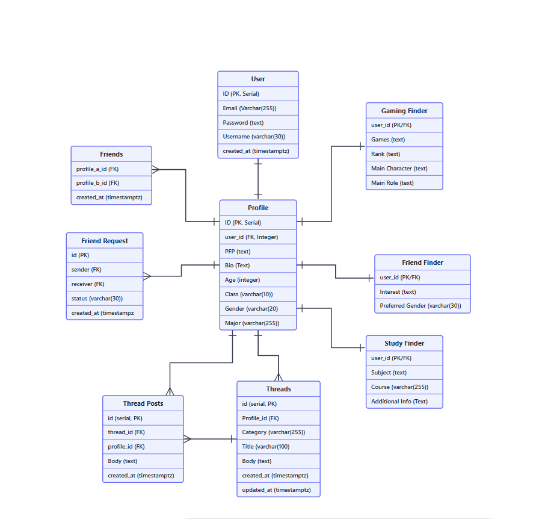

# Norm's Network
## Description
Welcome to Norm's Network, a hub for UNCC Students who are looking for people to talk to. Whether it be as a study buddy, a gaming partner, or a friend, NormsNetwork allows UNCC students to create a main profile for finding friends and navigate other parts of app to find the specific part they want and add information depending on the section they chose. Unlike other UNCC social networks, NormsNetwork seamlessly blends everything in one place so UNCC students don't have to go searching through tons of different apps to try and find people to communicate with.
## Sprint 3 Progress
Sprint 1 set up the database, the Express server, and placeholder pages. Sprint 2 added accounts, profiles, and a finished design for every page. Sprint 3 connected students to each other: they can say what kind of companion they're looking for, find real students on Discover and the Study Buddy and Gaming Partner finders, send and answer friend requests, open each other's profiles, and choose who can see their own profile.
### Completed this sprint
**What you're looking for, and partner profiles** (PR #41; issues #18, #19, #20, #21)
- Choose any mix of Friends, Study partners, Gaming partners, and Dating at `/profile/companions`
- Study partner profile: subject, up to 5 courses, what you need help with, when you can meet, and a favorite study spot
- Gaming partner profile: games, platforms, rank, main role, main character, play style, comms, and when you play
- Dating preferences, for students 18 and older only
**Study Buddy and Gaming Partner finders** (PR #43; issue #23)
- Both finders show real students instead of sample cards
- Study Buddy Finder: search, a course filter, and students who share the most courses with you listed first
- Gaming Partner Finder: search, game and platform filters, and students who play the most of your games listed first
**Discover and connections** (PRs #44, #45, #46; issues #22, #25, #26, #27, #29)
- Discover (`/discover`) lists other students' profiles, with search and 12 profiles per page
- **Connect** sends a friend request; the other student can accept or decline it
- The Friends page (`/friends`) shows incoming requests, sent requests, and accepted friends
- The database now rejects invalid request statuses, requests to yourself, and duplicate pending requests (migration 016)
**Profile privacy and student profile pages** (PRs #47, #48; issues #24, #28)
- Every student has a profile page at `/users/:username`
- Names on Discover, the Friends page, and the Study Buddy and Gaming Partner finders link to that page
- Choose who can open your profile: **Only me** (the default), **Campus**, or **Friends**
- Hide your age, gender, or bio from everyone except yourself (migration 017)
**Friend Finder** (branch `friend-finder-profile-link`, PR pending)
- Signed-in students see a real student whose profile they're allowed to see, instead of sample data
- **View profile** opens that student's page; it no longer opens your own profile
**Testing**
- More than 170 automated tests in 12 test files, now also covering companions, partner profiles, both finders, discovery, friend requests, connections, and privacy
- GitHub Actions still builds the app and runs every test against PostgreSQL 17 on each push and pull request
### Sprint 2 recap
- **Accounts and authentication** (PR #35): sign up with a UNC Charlotte email, log in with your email or username, and stay signed in for 7 days
- **React and TypeScript migration** (PR #36): strict TypeScript, and React pages rendered on the server
- **App screens and design** (PR #37): sign-up, log-in, and home screens, plus designs for every main page
- **Profiles** (PRs #38, #40): create, edit, and delete your profile; upload a profile photo; pick your major from UNC Charlotte's official program list
### Feature status
| Page | Route | Status |
|---|---|---|
| Sign up / Log in | `/signup`, `/login` | Working |
| Home | `/` | Working |
| Profile | `/profile` | Working, including privacy settings (login required) |
| What you're looking for | `/profile/companions` | Working (login required) |
| Study partner profile | `/profile/study` | Working (login required) |
| Gaming partner profile | `/profile/gaming` | Working (login required) |
| Dating preferences | `/profile/dating` | Working, 18+ only (login required) |
| Student profile | `/users/:username` | Working, follows the student's privacy settings (login required) |
| Discover | `/discover` | Search student profiles and send connection requests (login required) |
| Friend Finder | `/finder/friends` | Shows one real student once the `friend-finder-profile-link` PR is merged; logged-out visitors see sample data |
| Study Buddy Finder | `/finder/study` | Working: real students, search, and course filters (login required) |
| Gaming Partner Finder | `/finder/gaming` | Working: real students, search, and game and platform filters (login required) |
| Public Threads | `/threads` | Design complete, shows sample data |
| Friends | `/friends` | Incoming and sent requests, accept/decline, and accepted friends (login required) |
### Still to build
- **Apply the privacy settings everywhere.** Right now only `/users/:username` and the Friend Finder follow them. Discover, the Study Buddy and Gaming Partner finders, and the Friends page still show private profiles, including age and bio, and Discover serves their photos.
- Connect the Friend Finder to its own table (`friend_finder`: interests and hangouts), with search and interest filters
- A Connect button on finder cards and on `/users/:username`, so students don't have to go back to Discover to send a request
- Posting threads and replies (`threads`, `threads_reply` tables)
- Pronouns and concentration on the profile, which are listed in Intended Features but not in the form yet
## Intended Features
 ### Account & Verification
 - Sign-up with your verified UNC Charlotte email to ensure that only real UNCC students can join
 - Create a unique username and secure password.
 ### Main Profile
 - Profile picture
 - Personal Bio
 - Age, Gender, Pronouns
 - Class Standing
 - Major (option for concentration as well, if applicable)
 ### Finders for specialized interests (e.g. Study, Friend, Gaming)
 - Study Buddy finder: Input your subject, course, and additional info about what you need help with.
 - Gaming Partner finder: Input games you play, rank (or unranked), main character, main role, along with other important info for finding points of connection with other gamers. 
 - Friend Finder: Input hobbies/interests you have, places you like to go, and have the ability to filter by interests when looking for friends to make.
 ### Public Threads
 - Post public threads under a category (Study, Gaming, Friends, etc.) with a title and body.
 - Other students reply with thread posts, so you can find someone even if you don't know exactly where to look.
 - Ability to react to threads with likes and emoji reactions.
 - Threads track when they were created and last updated.
 ### Friend System
 - Send a friend request to another student.
 - Requests have a status (e.g., pending, accepted, declined) so senders and receivers can keep track.
 - Accepted requests will be added to your friends list.
## Technology Stack
- **Node.js 22.12+ and TypeScript (strict mode)**
- **React server-rendered pages with browser hydration; Vite for frontend assets**
- **Express 5 for routing and authentication**
- **PostgreSQL 17**
- **Kysely**
- **Docker Compose for local PostgreSQL**
- **Node's test runner + PGLite for local testing**
- **GitHub Actions for automated tests against PostgreSQL**
## Database
The database has thirteen tables, created by the 17 migrations in `migrations/`:
| Table | Purpose |
|---|---|
| `users` | Accounts: username, email, and password hash |
| `profiles` | Each student's main profile, including who can see it |
| `profile_photos` | Validated profile photo uploads |
| `companion_types` | What each student is looking for: friends, study, gaming, dating |
| `friend_finder` | Friend Finder entries |
| `study_finder` | Study partner profiles |
| `gaming_finder` | Gaming partner profiles |
| `dating_preferences` | Dating preferences (18+ only) |
| `threads` | Public threads |
| `threads_reply` | Replies to threads |
| `friend_request` | Friend requests and their status |
| `friends` | Accepted friendships |
| `sessions` | Login sessions (added in Sprint 2) |

The diagram was made in Sprint 1, so it doesn't show the `sessions`, `profile_photos`, `companion_types`, or `dating_preferences` tables,
the columns migrations 013 and 014 added to `study_finder` and `gaming_finder`, the friend request rules from migration 016,
or the privacy columns migration 017 added to `profiles`.
## Setup/Run Instructions
### 1. Clone the repository
```bash
git clone https://github.com/FinalBoolean/NormNetwork.git
cd NormNetwork
